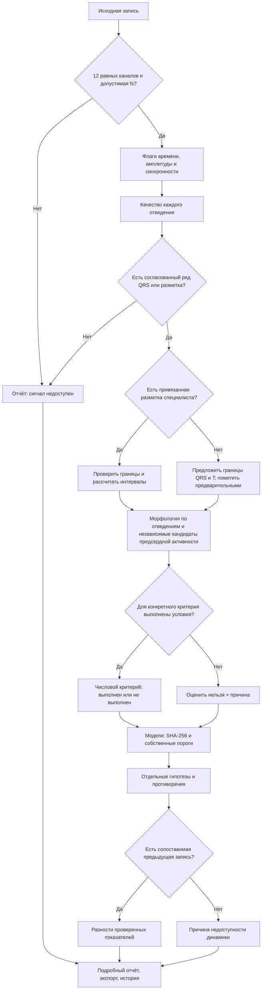

# Алгоритм 2 — исследовательский анализ ЭКГ, версия 2.0.0-research.1

Реализован в `app/js/analysis2.js`; подключён к карточке записи, подробному HTML-отчёту, экспорту JSON и сохраняемой истории расчётов. Краткая печать сохраняет прежние восемь пунктов. Подробный отчёт вызывается отдельной кнопкой.

## Путь выполнения



## Что реализовано

- Контракт входа: 12 равных массивов, 100–2000 Гц, 1 секунда минимум, не более 30 000 отсчётов; отказы не создают нормальный результат.
- Качество отдельных каналов; повреждённые и непригодные каналы исключаются из детектора.
- Многоканальный QRS-consensus; в новом модуле допускаются короткие фрагменты от 2 секунд с минимум тремя согласованными событиями. Это не меняет прежний минимум четырёх секунд в краткой сводке.
- Предварительные границы QRS/T по локальному порогу; отсутствующие границы остаются `null`.
- Независимый поиск кандидатов предсердной активности за пределами предложенных QRS/T; кандидаты не приравниваются к P и не задают источник ритма.
- Расчёт PR, P, QRS, QT, QTcB/QTcF при наличии соответствующих границ. Частота предсердий рассчитывается только из размеченных P, отдельно от ЧСС желудочков.
- Начальная q, R, S после первого положительного отклонения, минимум QRS, амплитуда ST в предложенной/размеченной J, фазы T. Полностью отрицательный QS не переименовывается в S.
- Ось по знаковым площадям только при проверенных границах, синхронности и одинаковом масштабе I/II.
- Соколов–Лайон с максимумом RV5/RV6; отсутствие пригодного S остаётся неизвестным.
- Условия применимости числовых критериев: широкий QRS, длинный PR, вольтажный критерий. Они не устанавливают тип блокады или анатомическую гипертрофию.
- ST-пороги по группам отведений формируют только исследовательскую гипотезу; статус клинического вывода остаётся «оценить нельзя», поскольку полный набор исключений не реализован.
- Модели требуют совпадающей SHA-256; для каждой метки нужен собственный порог. Старые вложения без привязки сохраняются, но не участвуют в новых гипотезах. Согласованы несколько однозначных меток ECGFounder/DeepECG; пороги не переносятся между моделями.
- Проверяемые расхождения модели и ширины QRS; динамика одного пациента по проверенным измерениям.
- HTML-отчёт, JSON и история расчётов с версиями, источником и ограничениями. Сохранение истории выполняется явной кнопкой.
- Сравнение записей больше не объявляет короткий интервал доказательством погрешности и широкий QRS доказательством вторичности всех ST–T изменений.

## Разметка специалиста

В карточке, в разделе подробного анализа, можно загрузить JSON:

```json
{
  "schemaVersion": 1,
  "sourceSha256": "64 строчных шестнадцатеричных символа SHA-256 исходной ЭКГ",
  "fs": 200,
  "reviewedBy": "Автор разметки",
  "reviewedAt": "2026-11-06T10:00:00Z",
  "beats": [
    {"pOnset": 40, "pEnd": 55, "qrsOnset": 70, "qrsPeak": 80, "qrsOffset": 90, "tEnd": 150}
  ]
}
```

Пример иллюстрирует схему, а не разметку реального пациента. Индексы — в исходных отсчётах блока сигнала; fs должна совпадать. P и T необязательны. Автор, дата и хеш — метаданные; они не подтверждают квалификацию автора. Разметка не подтверждает физические параметры файла автоматически. Предыдущая разметка сохраняется в `fiducialHistory`.

## Ограничения

Это работающая исследовательская реализация части расширенного плана. Автоматические границы не валидированы на экспертной выборке; полного классификатора сокращений, источника ритма, AV-проведения, морфологических типов блокад, U и синдромов пока нет. Эти пункты явно возвращают `unassessable`, а не отсутствие нарушения. Глобальная классификация — `incomplete`; нормальная ЭКГ автоматически не присваивается.

В изученных ECG301 время хранения, амплитуда и синхронность не подтверждены; окончательные физические критерии для них отключены. Модели заново не обучались и не запускались при разработке этого модуля.

## Источники

- [В.Н. Орлов, 7-е издание, 2012, §9.1, с.553–555](https://drive.google.com/file/d/1MXreNYQnhoVoEIEfVZwYGfzllDnofXyL/view): последовательность протокола, ограничения выводов.
- [ESC 2023, §3.2.1](https://academic.oup.com/eurheartj/article/44/38/3720/7243210): контекст и пороги J/ST. Проверены доступные индексируемые выдержки; полная спецификация исключений здесь не реализована.
- [AHA/ACCF/HRS, часть IV](https://www.ahajournals.org/doi/pdf/10.1161/CIRCULATIONAHA.108.191096): QT/QTc и необходимость проверки автоматических измерений.
- Существующие `docs/waveform-calculations.md` и `docs/review/textbook-audit-2026-11-05.md` сохраняют описание прежнего измерителя и причины ограничений.
