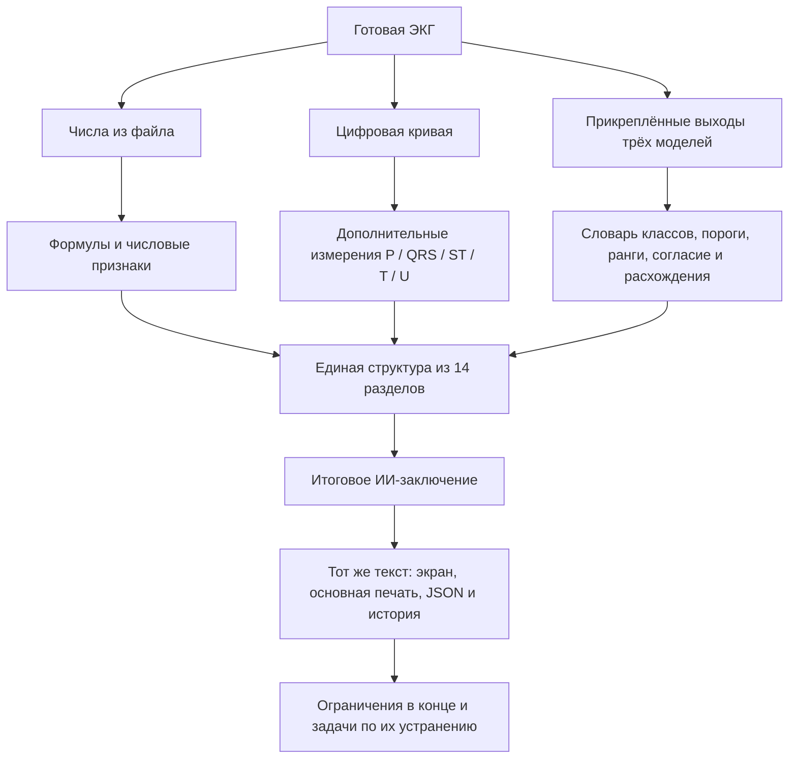

# Единое итоговое ИИ-заключение по структуре Орлова

Версия синтеза: `orlov-synthesis-1`. Версия приложения: 2.4.6.

## Назначение и вход

Готовый файл ECG301 даёт числовые показатели и цифровые кривые. Дополнительно используются прикреплённые выходы DeepECG SL, DeepECG SSL и ECGFounder. Основной результат — одно заключение в карточке ЭКГ, основной печати, JSON и истории. Восемь прежних строк больше не являются основным форматом отчёта; формат сохранён только для явного `compact: true`.

Проверки физического профиля не блокируют использование готовых показателей прибора. Числа из файла, производные формулы, предварительные измерения кривой и модельные гипотезы сохраняют разные источники. Технические сведения и ограничения находятся после результатов.

## Вычислительная цепочка

## Разделы и источники

| № | Раздел | Что используется |
|---|---|---|
| 1 | Ритм, ЧСС, внеочередные сокращения | ЧСС/RR файла, независимые предсердные измерения при наличии, классы моделей; происхождение и число сокращений не выводятся из одного балла |
| 2 | ЭОС | Числовые оси файла; знаковые площади I/II по кривой как предварительный резерв; возрастной норматив применяется только при известном возрасте |
| 3 | P и предсердия | P_onset/end, амплитуда/полярность по отведениям, длительность P, индекс Макруза, модельные признаки увеличения предсердий |
| 4 | Проведение | PR и QRS, укорочение/удлинение, гипотезы блокад и предвозбуждения, проверка противоречия с шириной QRS |
| 5 | QRS/Q/R | Начальная отрицательная фаза Q, её длительность/амплитуда, отдельный QS, прогрессия R, классы моделей |
| 6 | Вольтаж и увеличение камер | SV1+max(RV5,RV6), доступная сумма только с V5, RaVL, R/S в V1, RV1+|SV6|, размах QRS по группам отведений, модели |
| 7 | ST и J | Предполагаемая или размеченная J, измеренная амплитуда ST, модельные гипотезы элевации/депрессии по областям |
| 8 | T | Положительная/отрицательная фазы, полярность, двухфазность, модельные гипотезы |
| 9 | QT/QTc | QT, RR, формулы Базетта и Фридеричиа, взрослые ориентиры с учётом пола |
| 10 | U | Изолированные кандидаты после T и до следующего P/QRS, модельная метка U |
| 11 | Синдромы | Ведущие гипотезы ишемических/инфарктных паттернов, перикардита/ранней реполяризации, сочетание S_I–Q_III–T_III при наличии; неустановленные выводы обозначаются явно |
| 12 | Динамика | Одноимённые сопоставимые показатели предыдущей записи того же пациента |
| 13 | Суммарная оценка | Зарегистрированные числовые отклонения, модельные изменения или неполная классификация; тяжесть не берётся из величины балла |
| 14 | Уточнение | Действия, соответствующие полученным расхождениям и находкам |

## Формулы

- `meanRR = mean(RR_ms)`; `CV_RR = 100 × SD(RR) / mean(RR)`.
- `QTcB_ms = QT_ms / sqrt(RR_ms / 1000)`.
- `QTcF_ms = QT_ms / cbrt(RR_ms / 1000)`.
- `Macruz = P_ms / (PR_ms − P_ms)`, только при положительном сегменте PQ.
- `Sokolow = |SV1| + max(RV5, RV6)`; при отсутствии V6 доступная сумма с V5 называется отдельно.
- `QRS_T_angle = min(|QRS_axis−T_axis| mod 360, 360−разность)`.
- `axis = atan2((2×areaII−areaI)/sqrt(3), areaI)` — предварительный резерв по кривой, если числовой оси файла нет.

Данные имеют поле `source`, формулы — `formula` и `inputs`; признак `provisional` переносится от предварительных входов к производному результату.

## Объединение моделей

1. Проверить привязку результата к SHA-256 записи и исключить синтетический вход из медицинских гипотез.
2. Сопоставить однозначные названия DeepECG/ECGFounder. Порог проверяется по исходной метке данной модели; не по переведённому названию.
3. Сохранить все пороговые ответы. Ранжирование ECGFounder без порогов доступно как ранжирование и не становится бинарным диагнозом.
4. Для читаемого итога выделять пороговые ответы, попавшие в первые 10 оценок хотя бы одной модели. Внутри раздела сначала показывать согласие нескольких моделей, затем ведущие одиночные гипотезы.
5. Не выбирать между одновременно поддержанными несовместимыми ритмами по большему числу. Показать конфликт. Числовая ЧСС/ширина QRS отдельно сопоставляется с модельными названиями.
6. Классы, описывающие изменения «теперь», «больше», «исчезло», не применяются к одиночной записи как доказанная динамика.

Первые 10 оценок — правило представления, а не медицински валидированный порог. Оно внесено в реестр ограничений L14; нижние ответы не удаляются и доступны в источниках и JSON.

## Реализация

- `app/js/orlov.js` — единый набор данных, формулы, модели, разделы, выводы и ограничения.
- `app/js/orlov-waveform.js` — дополнительные измерения и кандидаты волн.
- `app/js/orlov-labels.js` — русские названия исходных классов DeepECG.
- `app/js/orlov-report.js` — HTML и форматирование чисел.
- `app/js/main.js` — основной экран и сохранение `conclusionHistory`.
- `app/js/report.js` — основная печать и сравнение двух заключений.
- `tests/js/orlov.test.mjs` — формулы, происхождение, противоречия, отсутствие вымышленных измерений и полнота разделов.

## Источники

- В.Н. Орлов. «Руководство по электрокардиографии», 7-е изд., 2012. §9.1, печатные с.553–555: измерения, описание, интерпретация, динамика и суммарное заключение. [Экземпляр пользователя](https://drive.google.com/file/d/1MXreNYQnhoVoEIEfVZwYGfzllDnofXyL/view).
- [University of Utah: систематический метод](https://ecg.utah.edu/lesson/2) — измерения, ритм, проведение, волны и динамика.
- [AHA/ACCF/HRS: ST–T–U и QT](https://www.ahajournals.org/doi/pdf/10.1161/CIRCULATIONAHA.108.191096) — коррекция QT и ограничения автоматических измерений.
- [ACC/AHA 2025: ACS, таблица 3](https://www.jacc.org/doi/10.1016/j.jacc.2024.11.009) — клинический контекст и пороги J/ST. Полный диагностический движок ACS этим синтезом не реализован.

## Границы результата

Покрыты разделы предоставленного плана и структура итогового протокола. Наличие всех разделов не означает реализацию всех диагностических правил всех глав 560-страничного руководства. Все ограничения и план их устранения ведутся отдельно в Obsidian: `КардиоИИ/Ограничения и план устранения.md`.
